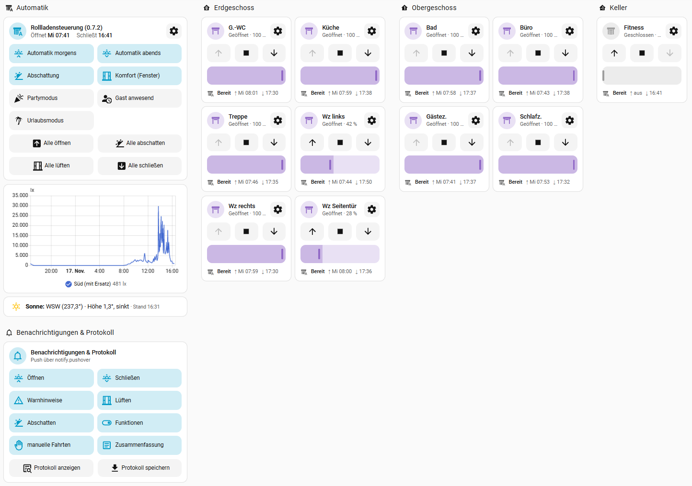

# Rollladensteuerung – shutter automation for Home Assistant

🇩🇪 [Deutsche Anleitung](README.de.md)

Automatic roller shutter control with sun protection and comfort functions for Home Assistant.
It is a re-implementation of the well-known FHEM shutter control by Bernd Hermanns and Matthias Frintrop
([FHEM forum thread](https://forum.fhem.de/index.php/topic,73964.0.html)) as a native Home Assistant
integration – configured entirely in the UI, with its own dashboard.

> The user interface and entity names are available in **German and English** (follows your HA language).
> Internal option keys are German (e.g. `offen_pos`, `abschattung`).



*The dashboard (German UI): automation and notifications on the left, shutters by floor with status and next opening/closing times.*

## Features

**Opening and closing**
- Open in the morning / close in the evening by **sun position** (sunrise/sunset, civil, nautical or
  astronomical twilight, or a custom horizon) with **earliest/latest limits**, or at a **fixed time**.
- Separate time for **weekends and holidays** (uses a workday sensor).
- Per-shutter **offset** and **random minutes**, so the house does not look automated.
- Mode per shutter: *always*, *only when someone is home*, *only when nobody is home*, *off*.
- **Frost protection** (don't open when freezing), **guest room** (stay closed while a guest is there),
  **party mode** (close only after the party), optional **sleep switch** (open only once it is off –
  the opening is caught up automatically).

**Windows and doors**
- Window **tilted** → ventilation position, door **open** (3-state handle sensor) → opened position,
  and back again when it is closed. Several contacts per shutter are supported.
- If a window is open at closing time, the shutter **closes as soon as the window is shut**.
- **Lock-out protection:** never moves down automatically while the door is open.

**Sun protection**
- Shading when the sun is within the window's **direction ± angle**, above a minimum **elevation**,
  with **two brightness thresholds** (sunny/cloudy) and a **pre-notice + waiting time**, so clouds don't
  make the shutter go up and down all the time.
- Only above a minimum **outdoor temperature**; optionally only if today's **weather forecast**
  reaches X °C; optionally only if the **room temperature** is above X °C (in winter the sun helps heating).
- **Dynamic shading position** (optional) from sun elevation, window height, sill height and the allowed
  sun penetration into the room – follows the sun, never darker than the fixed shading position.
- **Lock time after a manual move** and **before the evening closing**; return to the previous position
  only if the shutter was not moved in between.
- If shading is due while the door is open, the shutter shades **after the door is closed**.

**Extras (global settings, all optional)**
- **Fire protection:** on a smoke alarm all shutters open (escape route) and nothing moves down automatically until the alarm is over.
- **Heat protection when away:** above X °C (measured or forecast) and nobody at home, shading goes to a darker position.
- **Close at dusk:** in the evening the shutters close as soon as it is darker than X lux – not before *close earliest*.
- **Vacation mode** (switch on the central card): weekend/holiday times every day and extra random minutes.
- **Daily summary** (switch on the notifications card): one push in the evening with what happened today.

**Notifications and log**
- Choose a **push service** (HA companion app, Pushover, … – any `notify` service; a script with `title`/`message` can be typed in).
- Switches for what you want as push: **opening started** and **closing started** (one message for all shutters),
  **warnings** (not opened because of frost, window still open at closing time, lock-out protection, a sensor or shutter
  unreachable for 15 minutes, a shutter that did not reach its target position), **ventilation**, **shading** (start and end),
  **functions** (automation switched on/off) and **manual moves**.
- A **log of the last 14 days** with all actions – automatic and manual moves, skipped moves and why, switched functions,
  warnings – viewable and filterable on the dashboard and downloadable as CSV.

**General**
- **Staggered commands** with an adjustable delay (protects e.g. the Homematic duty cycle) – also for
  **open all / ventilate all / shade all / close all**, each shutter to its own configured position.
- Shutters and brightness sensors are **added, changed and removed in the UI**; hidden entities are not offered.
- **Renamed entities are followed automatically** (also renames made while the integration was not running); entities
  that no longer exist or are disabled are reported under *Settings → Repairs*, where you pick a replacement directly.
- **Robust against restarts and radio dropouts:** a window contact that is briefly unavailable and comes back with the same
  value is no change; commands wait after a start until Home Assistant runs and the shutter is reachable (max. 5 min),
  and nothing is sent while Home Assistant shuts down.
- Sensors for the **next opening/closing**, a **status sensor** with all internal flags, and the event
  `rollladensteuerung_fahrt` for your own notifications.
- **Dashboard included:** shutter cards with a gear button (status and all settings as tabs),
  a central card for the global switches and settings, and a dashboard strategy that builds the
  view automatically (grouped by floor; new shutters appear automatically), and automatic sections
  for your own, freely arranged dashboards.

## Requirements

- Home Assistant **2025.6** or newer (uses config sub-entries and sections).
- Cover entities with position (0 % = closed, 100 % = open). Covers without position are opened/closed.
- Optional: brightness sensor(s) (lux), outdoor temperature, presence (`binary_sensor`, `person`, `group` …),
  workday sensor, weather entity, room temperature sensors, window contacts or handle sensors.

## Installation

### Marketplace / HACS
[](https://my.home-assistant.io/redirect/hacs_repository/?owner=Cluni2k&repository=ha-rollladensteuerung&category=integration)

1. Click the button above (it opens the Marketplace from Home Assistant 2026.11, HACS before) – or add
   `https://github.com/Cluni2k/ha-rollladensteuerung` as a custom repository, category **Integration**.
2. Install **Rollladensteuerung** and restart Home Assistant.

### Manual
Copy `custom_components/rollladensteuerung` to `/config/custom_components/` and restart Home Assistant.

## Setup

1. *Settings → Devices & services → Add integration → Rollladensteuerung*.
   Choose presence, outdoor temperature, workday sensor and (optionally) a weather entity.
2. In the integration: **Add brightness sensor** (one or more).
3. **Add shutter** – one dialog with the sections *Basics, Times, Positions, Window, Sun protection*.
   New shutters start with sensible defaults (the defaults of the original FHEM control).

Everything can be changed later – in the integration (⋮ → *Reconfigure*) or directly on the dashboard.

## Dashboard

The integration ships its own cards and a dashboard strategy – no extra frontend installation needed.

**Whole dashboard:** create a new dashboard → ⋮ → *Raw configuration editor*:
```yaml
strategy:
  type: custom:rollladensteuerung
```

**As one view in an existing dashboard:**
```yaml
views:
  - strategy:
      type: custom:rollladensteuerung
      title: Shutters
```

By default the floors come first and the central cards after them; `steuerung: vorne` puts them first.

**Single cards:**
```yaml
type: custom:rollladensteuerung-card
entity: cover.living_room
```
```yaml
type: custom:rollladensteuerung-zentrale-card
```

The gear on a shutter card opens a dialog with the tabs *Status, Basics, Times, Positions, Window,
Sun protection*. The gear on the central card opens the global settings. Changing settings requires an
administrator account.

**Arranging it yourself (recommended, HA 2026.11+): automatic sections.** In a normal sections view choose
*Add section → Automatic section → Community*. There are three sections:

| Section | Content | Settings |
|---|---|---|
| *Shutters (Rollladensteuerung)* | all shutters of one floor, sorted by name | floor (or *All shutters* / *without floor*), heading |
| *Shutter control – automation* | central card with switches, all buttons and gear, brightness history with the current sun position (direction and elevation) | heading, brightness history on/off |
| *Shutter control – notifications* | push switches and log | heading |

Move the sections around freely and mix them with your own cards; the layout is stored in your dashboard and survives
updates. New shutters still appear automatically in the section of their floor (floor of the shutter's area or its
device's area). Only a completely new floor needs a new section. In YAML:
```yaml
type: sections
sections:
  - strategy:
      type: custom:rollladensteuerung
      stockwerk: ground_floor
  - strategy:
      type: custom:rollladensteuerung-steuerung
  - strategy:
      type: custom:rollladensteuerung-meldungen
```

The view built by the dashboard strategy above, on the other hand, is generated and read-only.

## Settings reference (per shutter)

| Section | Setting | Meaning |
|---|---|---|
| Basics | Open / close automatically | always, only when someone is home, only when nobody is home, off |
| | Frost protection | don't open in the morning at or below the frost temperature |
| | Guest room / Party mode | stay closed while a guest is present / close after the party |
| | Sleep switch | open only once the switch is off (opening is caught up) |
| Times | Open by / Close by | sun (with limits) or fixed time |
| | Earliest / latest | limits on workdays; separate time for weekends/holidays |
| | Offset, random | shift in minutes, random ± minutes |
| Positions | Open, closed, ventilation, opened | target positions in % |
| | After the door closes | -1 = previous position, -2 = opened position, or a value |
| Window | Contacts | binary sensors (open = tilted) or 3-state handle sensors (closed/tilted/open) |
| | Lock-out protection | never move down while the door is open |
| Sun protection | Mode, brightness sensor | off, on, delayed, only when (nobody) home |
| | Direction, angle left/right | window direction (90 = east, 180 = south, 270 = west) and range |
| | Thresholds sunny/cloudy | shade above / end below (lux) |
| | Min. outdoor / forecast / room temp | conditions for shading |
| | Shading position, dynamic | fixed position, or computed from sun elevation and window geometry |
| | Waiting time, lock times | between moves, after a manual move, before evening closing |

Global settings: presence, outdoor temperature, workday sensor, sun, astro mode morning/evening,
frost temperature, minimum brightness for the shading check, weather entity, delay between commands.

## Services

| Service | Description |
|---|---|
| `rollladensteuerung.alle_oeffnen` | every shutter to its open position (staggered) |
| `rollladensteuerung.alle_lueften` | every shutter to its ventilation position (staggered) |
| `rollladensteuerung.alle_abschatten` | every shutter with sun protection enabled down to its shading position (staggered) |
| `rollladensteuerung.alle_schliessen` | every shutter to its closed position (staggered) |
| `rollladensteuerung.zusammenfassung_senden` | send today's summary as push now |
| `rollladensteuerung.neu_berechnen` | recalculate the next opening/closing times |
| `rollladensteuerung.abschattung_pruefen` | run the sun protection check now |

Event `rollladensteuerung_fahrt` with `rollladen`, `entity_id`, `position`, `grund` (reason) is fired for every automatic move.

## Development

The logic lives in `custom_components/rollladensteuerung/core.py` without Home Assistant dependencies
and is covered by tests: `python -m pytest tests`. Translations are generated with `python tools/uebersetzungen.py`.

## Credits and license

Original FHEM shutter control © 2018 Bernd Hermanns and Matthias Frintrop.
Ported to Home Assistant by Bernd Hermanns together with Claude (Anthropic's AI assistant).
See [LICENSE](LICENSE).

Use at your own risk – automatically moving shutters can lock people out or trap fingers;
check the lock-out protection for doors.
